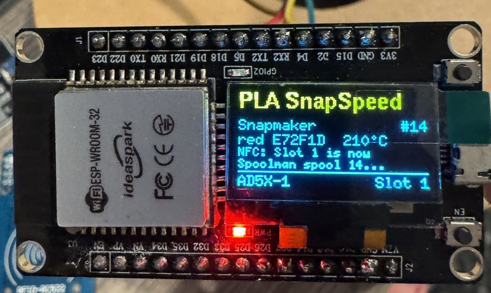

# zmod_esp32-nfc

A Wi-Fi NFC/RFID filament tag reader for the **Flashforge AD5X** and
**Flashforge Creator 5**, built from an **ESP32** and a **PN532**, **RC522**
or **PN5180** module.
Hold a spool's tag to the reader and the printer's slot gets the spool's
material and colour. One reader can serve several printers, running stock
firmware or [Zmod](https://github.com/ghzserg/zmod), and needs no USB port on
the printer. Everything is set up on the reader's own web page: Wi-Fi,
printers and their IP addresses, and how each printer is reached.

## What your printer needs

> **Works on a new, out-of-the-box stock Flashforge AD5X or Creator 5 with
> no modding at all.** Nothing is installed on the printer: the reader uses
> the local network API that Flashforge's own firmware already has (the one
> OrcaSlicer and FlashPrint use). On a stock printer a scan sets the
> **slot's material and colour** - that is all the stock API offers.

Everything beyond that needs [**Zmod**](https://github.com/ghzserg/zmod).
The two plugins below are **optional extras, not requirements**:

| Printer runs | What a scan gets you |
|--------------|----------------------|
| **Stock Flashforge firmware** (no mods) | Slot material and colour. The colour is matched to the closest one the stock screen can show. |
| **Zmod** | The same, through Moonraker, plus the slot's **lane data** for OrcaSlicer. No plugin needed ("Zmod basic"). |
| **Zmod + [zmod_nfc](https://github.com/DIEHARDave/zmod_nfc)** (optional plugin) | The full integration: every tag format decoded on the printer, **Spoolman** spool matching, the slot **popup on the printer's screen** (or just insert the filament), and lane data with the spool's details - the same as a USB reader plugged into the printer. |
| **+ [zmod_afclite](https://github.com/DIEHARDave/zmod_afclite)** (optional plugin, with zmod_nfc) | Each IFS slot (or Creator 5 toolhead) keeps track of its own Spoolman spool, and Moonraker's active spool follows the one in use. zmod_nfc works without it. |

Without zmod_nfc the printer cannot ask which slot a spool goes in, so each
printer is given a fixed slot on the reader (see
[Printer methods](#printer-methods)).

```
           ┌──── ESP32 + PN532/RC522/PN5180 ───┐
 tag ────► │ read the whole tag (NTAG, MIFARE   │
           │ Classic with Bambu/Creality/       │
           │ Snapmaker keys, Type 4; ISO 15693  │
           │ / OpenPrintTag on the PN5180)      │
           └──────┬──────────────┬──────────┬───┘
                  │              │          │
      Zmod + zmod_nfc      Zmod basic     Stock firmware
      Moonraker ──► plugin Moonraker      Flashforge local API
      decode, Spoolman,    CHANGE_ZCOLOR  msConfig_cmd
      slot popup on the    + lane_data    (material + colour)
      printer, lane_data
```

> **Status: early release.** Tested on an **ESP32-C3 SuperMini** with a
> **PN532 over I2C**: OpenSpool (NTAG) and Snapmaker (MIFARE Classic, keys
> derived from the UID) tags, assigned on a **Creator 5** and an **AD5X**
> running Zmod and zmod_nfc (from the printer's prompt and with the reader
> fixed to one slot), and to an **AD5X's stock screen** through the stock
> API (Flashforge's own screen program, run under Zmod's `DISPLAY_ON`; the
> same program and API as an unmodified printer). The firmware
> builds for ESP32, ESP32-S3 and ESP32-C3 without warnings. Its decoders and
> MIFARE key derivation match [zmod_nfc](https://github.com/DIEHARDave/zmod_nfc)'s
> (identical results for every tag in zmod_nfc's decoder tests, identical
> Bambu, Creality and Snapmaker keys). Not yet tried: Bambu and Creality
> tags, a factory-fresh printer, the stock method on the Creator 5, and
> the **Zmod basic** method. The PN532 works over I2C (ESP32-C3) and HSU
> (classic ESP32), and the RC522 read tags on an ESP32-C3. **PN5180
> support has not been run on hardware yet** (it builds; its driver is
> written from the NXP datasheet, its command layer follows zmod_nfc's). The OpenPrintTag decoder gives the same results as
> zmod_nfc's on its six OpenPrintTag test dumps. Reports are welcome.

## Printer methods

Each printer on the reader's list uses one of three methods:

| Method | Printer runs | What a scan does |
|--------|--------------|------------------|
| **Zmod + zmod_nfc** | Zmod with the [zmod_nfc](https://github.com/DIEHARDave/zmod_nfc) plugin | The **whole tag read** goes through Moonraker to the plugin (no extra port or service on the printer), which handles it exactly like a tag on a USB reader plugged into the printer: it decodes every format zmod_nfc knows, looks the spool up in **Spoolman** (spool ID on the tag, or the tag's UID), shows its **slot popup on the printer's screen** (or takes the slot you insert filament into), sets the slot through zmod_afclite's `SET_SPOOL_ID` or Zmod's `CHANGE_ZCOLOR`, and fills in Moonraker's **lane_data** for OrcaSlicer. The reader's web page can pick the slot too. |
| **Zmod basic** | Zmod, no plugin | Material and colour go to the slot through Moonraker (`CHANGE_ZCOLOR`), snapped to Zmod's material list and colour palette, and the slot's **lane_data** entry gets the material, colour, vendor, temperatures and the tag's Spoolman spool ID if it carries one. No Spoolman lookup. |
| **Stock firmware** | Flashforge firmware | Material and colour through the printer's local API (`msConfig_cmd` on port 8898) - that is all the stock API offers. Needs the printer's **serial number** and **check code**. The stock screens can only draw their own 24 colours (a different set on each model), so the colour is snapped to the closest one (CIEDE2000), and on the Creator 5 the material to its list. |

> **Stock firmware and Zmod basic: give each printer a fixed slot.** Only
> zmod_nfc can show a "which slot?" popup on the printer's screen. With the
> other two methods the printer cannot ask, so set **Slot for this reader**
> on the Printers tab (new stock and Zmod basic printers start on slot 1):
> every scan then fills that slot by itself. If you choose **"Ask on this
> web page"** instead, nothing is set until you pick the slot on the
> reader's web page after each scan, so that page has to be open in a
> browser (a phone works) whenever you scan. See
> [One reader per slot](#one-reader-per-slot) for one reader per slot.

## Hardware

* An **ESP32** board: classic ESP32 (DevKit, WROOM-32), ESP32-S3 or
  ESP32-C3 (SuperMini works).
* A reader module, one of:
  * a **PN532**, e.g. the common red or blue "PN532 NFC RFID V3" boards or
    Elechouse's (good range, the tested one);
  * an **RC522** (MFRC522), the cheap blue "RFID-RC522" board, on SPI;
  * a **PN5180** board, on SPI. The only one of the three that also reads
    **ISO 15693** tags (ICODE SLIX/SLIX2), which **OpenPrintTag** uses.

  All three read ISO 14443A tags: NTAG21x, MIFARE Ultralight, MIFARE
  Classic and Type 4.
* ESP32-C3 SuperMini boards have a weak antenna. If the reader drops off
  your network, change **Settings > Wi-Fi transmit power**: the usual advice
  of 8.5 dBm lost most packets on the tested board, which worked well from
  11 dBm up (15 dBm is the C3 default).
* Optional: an LED and an **active** buzzer. The board's own LED is used by
  default (GPIO 2 on ESP32 DevKits, GPIO 8 on the C3 SuperMini), and its
  BOOT button picks the slot (GPIO 0, GPIO 9 on the C3; see
  [Choosing the slot with the button](#choosing-the-slot-with-the-button)).
* Optional: a 128x64 I2C OLED (SSD1306 0.96" or SH1106 1.3"), see
  [The display](#the-display).

### Wiring

Pick the reader on the web page (**Settings > NFC reader**); the pins
below are the defaults and can all be changed there.

#### PN532

Power the PN532 from **3.3 V**, so its signals stay at the ESP32's 3.3 V
levels. Set the PN532's mode switches for the bus you use:

| Mode | Switch 1 (SEL0) | Switch 2 (SEL1) |
|------|-----------------|-----------------|
| I2C (default) | ON | OFF |
| HSU (UART) | OFF | OFF |

Default pins (all can be changed on the web page):

| Board | I2C SDA | I2C SCL | UART RX (to PN532 TXD) | UART TX (to PN532 RXD) | LED | Button |
|-------|---------|---------|------------------------|------------------------|-----|--------|
| ESP32 | 21 | 22 | 16 | 17 | 2 | 0 (BOOT) |
| ESP32-S3 | 8 | 9 | 18 | 17 | none | 0 (BOOT) |
| ESP32-C3 | 6 | 7 | 20 | 21 | 8 (lit when low) | 9 (BOOT) |

```
PN532          ESP32 (I2C)          PN532          ESP32 (HSU)
 VCC  ──────── 3V3                   VCC  ──────── 3V3
 GND  ──────── GND                   GND  ──────── GND
 SDA  ──────── GPIO 21               TXD  ──────── GPIO 16 (RX)
 SCL  ──────── GPIO 22               RXD  ──────── GPIO 17 (TX)
```

**If the PN532 is not found on I2C, try HSU.** The I2C pins double as the
HSU pins (SDA is TXD, SCL is RXD), so no wire moves: set both switches OFF,
choose HSU on the Settings tab with **RX** = the GPIO that SDA is on and
**TX** = the GPIO that SCL is on, and power the PN532 off and on (it reads
its switches only at power-up). On an Ideaspark "ESP32 OLED 0.96" board,
two PN532 V3 boards that work on I2C on an ESP32-C3 held SCL low and were
never found on I2C, and both worked in HSU. The reader's status names an
I2C line that stays low.

The PN532's SPI mode (switch 1 OFF, switch 2 ON) is not supported.

#### RC522

The RC522 is a **3.3 V only** chip: power it from 3V3, never 5 V. It talks
SPI; its **SDA** pin is the SPI chip select. IRQ stays unconnected. RST can
go to 3V3 instead of a GPIO (set the RST pin to -1).

| Board | SCK | MISO | MOSI | SDA (SS) | RST |
|-------|-----|------|------|----------|-----|
| ESP32 | 18 | 19 | 23 | 5 | 4 |
| ESP32-S3 | 12 | 13 | 11 | 10 | 14 |
| ESP32-C3 | 4 | 5 | 6 | 7 | 3 |

```
RC522          ESP32
 3.3V ──────── 3V3
 GND  ──────── GND
 SDA  ──────── GPIO 5
 SCK  ──────── GPIO 18
 MOSI ──────── GPIO 23
 MISO ──────── GPIO 19
 RST  ──────── GPIO 4
 IRQ           (not connected)
```

The RC522's antenna is small: hold the tag flat on the board, within
2-3 cm. One tag at a time: with two tags in the field the RC522 reads
neither.

#### PN5180

The usual PN5180 boards have both a **5V** pin (the RF transmitter) and a
**3.3V** pin (the chip's logic and its SPI levels): connect both. Besides
SPI it needs **BUSY**; RST is optional (-1 when it is not wired). IRQ,
GPIO, AUX and REQ stay unconnected.

| Board | SCK | MISO | MOSI | NSS | BUSY | RST |
|-------|-----|------|------|-----|------|-----|
| ESP32 | 18 | 19 | 23 | 5 | 27 | 4 |
| ESP32-S3 | 12 | 13 | 11 | 10 | 15 | 14 |
| ESP32-C3 | 4 | 5 | 6 | 7 | 10 | 3 |

```
PN5180         ESP32
 5V   ──────── 5V (VIN)
 3.3V ──────── 3V3
 GND  ──────── GND
 NSS  ──────── GPIO 5
 SCK  ──────── GPIO 18
 MOSI ──────── GPIO 23
 MISO ──────── GPIO 19
 BUSY ──────── GPIO 27
 RST  ──────── GPIO 4
```

The PN5180 looks for an ISO 14443A tag and an ISO 15693 tag in turn, so a
tag can take a moment longer to be noticed than on the PN532. One tag at a
time, as with the RC522.

## Install

Build and flash with [PlatformIO](https://platformio.org/) (the VS Code
extension, or `pip install platformio`):

```sh
pio run -e esp32dev -t upload      # classic ESP32
pio run -e esp32-s3 -t upload      # ESP32-S3
pio run -e esp32-c3 -t upload      # ESP32-C3
pio device monitor                 # log output
```

Later updates can be uploaded from the web page (**Settings > Firmware**,
the file is `.pio/build/<board>/firmware.bin`).

## Setup

1. On first start the reader opens a Wi-Fi network **`zmod-nfc-setup-xxxx`**
   (password **`zmodnfc1`**). Join it; the setup page opens (or browse to
   `http://192.168.4.1`). The LED blinks slowly while the setup network is
   up.
2. Under **Settings**, enter your Wi-Fi network and password and save. The
   reader restarts and joins it. If it cannot connect within 30 seconds,
   the setup network comes back, and the reader tries your network again
   every 30 seconds (every two minutes while someone is connected to the
   setup network, since each try briefly disturbs it).
3. Open the reader at **`http://zmod-nfc-xxxx.local`** (the name is on the
   Settings tab) or its IP address from your router.
4. Under **Printers**, add each printer: name, IP address, AD5X or
   Creator 5, and the method. **Test** checks the connection.
   * **Zmod + zmod_nfc**: install or update zmod_nfc on the printer. The
     reader reaches it through Moonraker (port 7125); zmod_nfc adds
     endpoints to Moonraker's API rather than opening a port of its own.
   * **Zmod basic**: nothing to install; uses Moonraker on port 7125.
   * Both Zmod methods work when the reader's address is in Moonraker's
     `[authorization] trusted_clients`, which Zmod sets to every address by
     default. If you narrowed it, enter a Moonraker API key.
   * **Stock firmware**: enter the printer's serial number and its check
     code, the code the printer shows for LAN connections (the one
     OrcaSlicer and FlashPrint ask for when you add the printer).
5. On the **Scan** tab, choose which printer scans go to, and hold a tag to
   the reader.

You can also set a password for the web page (user `admin`) under
**Settings**.

## Using it

The **Scan** tab shows the last tag: its colour, what it decoded to and what
the printer did, plus the target printer's slots.

* **Zmod + zmod_nfc:** the printer's screen asks which slot the spool goes
  in, just like with a USB reader. Tap a slot there, insert the filament
  into an empty slot, or click a slot on the reader's page. **Send to
  printer again** reopens the popup.
* **Zmod basic / stock:** with a fixed slot, the scan fills it straight away
  (the LED gives a long blink when the printer took it). With "Ask on this
  web page", keep the reader's page open and click the slot after each
  scan; the printer's screen cannot ask.

### One reader per slot

On the Scan tab, click a slot (or **Ask**) to choose where the next scans
of the active printer go; the chosen one is outlined and marked "next scan".
Only while a scan waits for its slot does a click put that scan there.

Each printer entry has a **Slot for this reader** setting. Set it, and every
scan on this reader goes straight into that slot (or toolhead on the
Creator 5) with no question asked. Mount one reader at each IFS slot, set
each to its own slot, and a spool is assigned just by setting it on its
slot's reader.

With zmod_nfc, everything else still happens: the Spoolman lookup, lane
data, and Zmod's colour popup is skipped when you then insert the filament.
A reader can have a fixed slot on one printer and ask on another.

The LED (and buzzer) signal: a short blink when a tag is read, a long one
when the printer took it, three short ones on an error.

### Choosing the slot with the button

The board's **BOOT button** changes the slot of the active printer (the one
picked on the Scan tab; choosing the printer stays on the web page):

* Press once: the LED shows the current slot - one blink for slot 1 (T0 on
  the Creator 5), two for slot 2, and so on; one long blink means "ask".
* Press again within 5 seconds of the last press: on to the next slot, and
  the LED shows it. The order is ask, 1, 2, 3, 4, ask, ...

The next scan goes into the shown slot. The choice is the same setting as
**Slot for this reader** on the Printers tab, and is saved 5 seconds after
the last press. Another button (wired from a GPIO to GND) can be set under
**Settings > Slot button pin**, or -1 to turn this off. Don't hold BOOT while
the board resets or powers up: that starts the ESP32's flash mode.

### The display



With an OLED set up under **Settings > Display**, the reader shows:

* at the bottom, the active printer and its slot (`Ask`, `Slot 1`-`4` on the AD5X, `T0`-`T3`
  on the Creator 5); pressing the slot button shows the slot in large type
* after a scan, the filament it found: the material in the top 16 rows (the
  yellow band on two-colour OLEDs), brand, the Spoolman spool
  (`#19`), a colour name with its hex value (the screen is monochrome) and
  the nozzle temperature, then what happened (sent, assigned, pick the slot
  on the printer, or the error). Tags only the zmod_nfc plugin can decode show
  the printer's name for the spool.
* with no scan for 5 minutes: "Ready" and the IP address, or the reader error
* in setup mode: the setup network, its password and the address to open

The screen turns off after 10 minutes without a change (OLEDs burn in) and
comes back on the next scan or button press; **Screen off after** changes
this. The display may share the PN532's I2C pins. A display on other pins
needs a second I2C bus, which the ESP32-C3 does not have. Boards with a
built-in 0.96" OLED (Ideaspark ESP32 and similar) have it on SDA 21 / SCL 22
at 0x3C.

## Tag formats

| Format | Decoded on the reader | Decoded by zmod_nfc |
|--------|-----------------------|---------------------|
| OpenSpool (NDEF JSON) | yes | yes |
| Spoolman links and nfc2klipper `SPOOL:` | spool ID only | yes, with the Spoolman lookup |
| Bambu Lab (MIFARE Classic) | yes | yes |
| Creality (MIFARE Classic) | yes | yes |
| Snapmaker U1 (MIFARE Classic) | yes | yes |
| SpoolEase, Anycubic, Elegoo, Qidi | yes | yes |
| Simple text (`PLA:FF0000`, JSON) | yes | yes |
| TigerTag, OpenTag3D | no | yes |
| OpenPrintTag (ISO 15693) | yes, with a PN5180 (the PN532 and RC522 cannot read ISO 15693) | yes |

The reader derives the Bambu, Creality and Snapmaker MIFARE keys from each
tag's UID, as zmod_nfc does, so those tags are read completely. With the
zmod_nfc method the raw read is decoded on the printer, so every format
zmod_nfc supports works, including ones the reader does not decode itself.

## Notes

* The reader and the printers talk plain HTTP on your local network. Do not
  expose the reader or the printers to the internet. Set a page password if
  others share your network.
* A tag that only names a Spoolman spool (a Spoolman QR/NFC link) has no
  material or colour of its own: use the zmod_nfc method, which looks it up.
* The reader sends a tag once; take it away and back to send it again, or
  press **Read the tag again**.

## Web API

The page uses a small JSON API, also usable from scripts: `GET /api/status`
(reader, Wi-Fi, last scan), `GET/POST /api/config`, `POST /api/active
{"printer": n}`, `GET /api/slots?printer=n`, `POST /api/assign
{"printer": n, "slot": s}`, `POST /api/fixed_slot {"printer": n, "slot": s}`
(0: ask), `POST /api/resend`, `POST /api/cancel`,
`POST /api/test`, `POST /api/rescan`, `GET /api/networks`,
`POST /api/restart` and `POST /update` (firmware). The protocol between the
reader and zmod_nfc is in zmod_nfc's
[docs/remote-api.md](https://github.com/DIEHARDave/zmod_nfc/blob/main/docs/remote-api.md).

## Credits

The tag reading, decoders and key derivations are ported from
[zmod_nfc](https://github.com/DIEHARDave/zmod_nfc), which adapted them from
[OpenRFID](https://github.com/suchmememanyskill/OpenRFID) (GPL-3.0), building
on the Bambu Research Group RFID guide, the Creality CFS RFID research,
DnG-Crafts' ACE-RFID and U1-RFID, and the TigerTag project. The stock
Flashforge API details come from GhostTypes'
[ff-5mp-api](https://github.com/GhostTypes/ff-5mp-api-ts) documentation.

## License

GPL-3.0, see [LICENSE](LICENSE).
