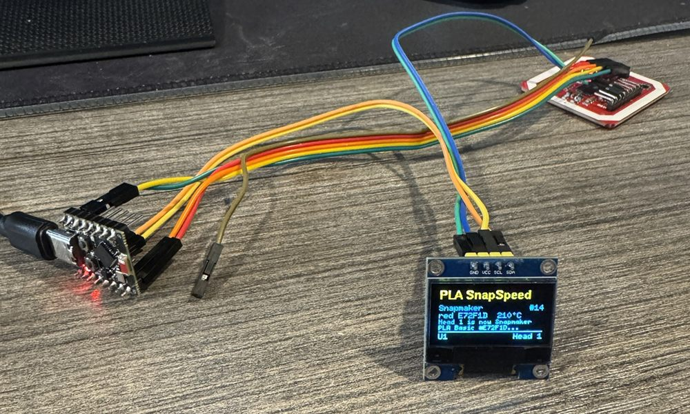
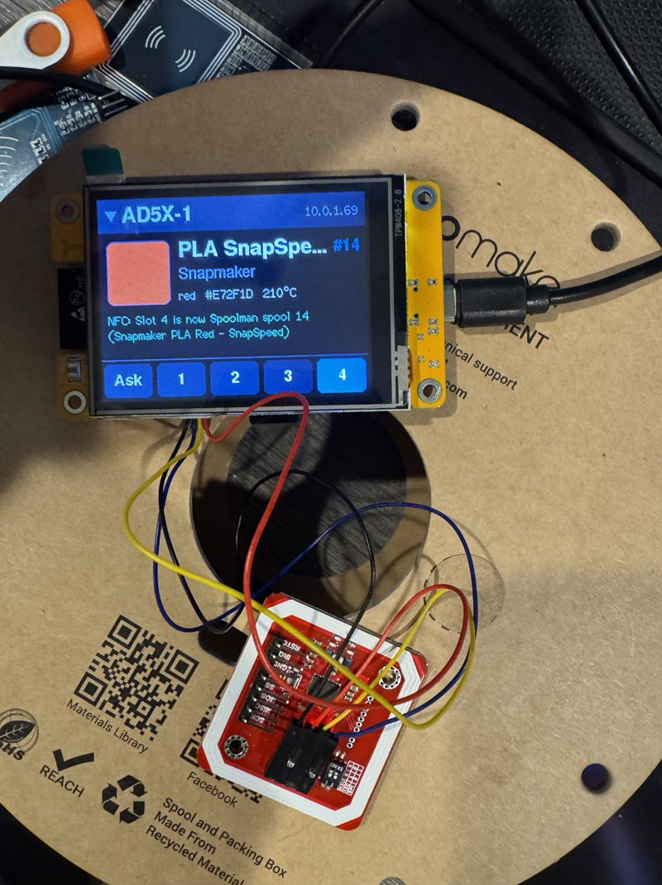

# LaneTag

A Wi-Fi NFC/RFID filament tag reader for 3D printers, built from an
**ESP32** and a **PN532**, **RC522** or **PN5180** module. Printers
supported today: the **Flashforge AD5X**, the **Flashforge Creator 5**,
the **Snapmaker U1** (stock firmware, or paxx12's
[Extended firmware](https://github.com/paxx12-snapmaker-u1/SnapmakerU1-Extended-Firmware)
for Spoolman matching),
**Bambu Lab** printers with an AMS or external spool in LAN mode,
**Creality K1 / K2 / Hi** printers with a CFS on stock firmware,
**Anycubic Kobra** printers (Kobra 3 / S1 generation) with an ACE in LAN
mode, **Qidi Plus4 / Q2 / Max4** printers with a Qidi Box on stock firmware,
and
**Klipper** printers through Moonraker: **Happy Hare** MMUs, **AFC** units
(Box Turtle, Night Owl, ...) and plain Moonraker lane data, which is also
what the **Flashforge AD5M** on Zmod or Forge-X gets. With no printer at
all, it can be a stand-alone reader for **Spoolman** (find, bind and add
spools; tested on an ESP32-C3 with Spoolman 0.27.0). The Anycubic,
Bambu, Creality, Klipper and Qidi methods are not yet tested on real
printers.

> Formerly **zmod_esp32-nfc**. Boards running that firmware keep their
> settings when updated to LaneTag (see [Updating from
> zmod_esp32-nfc](#updating-from-zmod_esp32-nfc)).

Hold a spool's tag to the reader and the printer's slot gets the spool's
material and color. One reader can serve several printers, running stock
firmware or [Zmod](https://github.com/ghzserg/zmod), and needs no USB port on
the printer. Everything is set up on the reader's own web page: Wi-Fi,
printers and their IP addresses, and how each printer is reached.

> **Status: early release.** Tested on an **ESP32-C3 SuperMini** with a
> **PN532 over I2C & HSU**: OpenSpool (NTAG) and Snapmaker (MIFARE Classic, keys
> derived from the UID) tags, assigned on a **Creator 5** and an **AD5X**
> running Zmod and zmod_nfc (from the printer's prompt and with the reader
> fixed to one slot), and to an **AD5X's stock screen** through the stock
> API, and to an unmodified
> **Creator 5 Pro on stock firmware**. The firmware
> builds for ESP32, ESP32-S3, ESP32-C3 and ESP32-C6 without warnings. Its decoders and
> MIFARE key derivation match [zmod_nfc](https://github.com/DIEHARDave/zmod_nfc)'s
> (identical results for every tag in zmod_nfc's decoder tests, identical
> Bambu, Creality and Snapmaker keys). Not yet tried: Bambu and Creality
> tags, a factory-fresh printer, and
> the **Zmod basic** method. The PN532 works over I2C and HSU (ESP32-C3 and
> classic ESP32), and the RC522 read tags on an ESP32-C3. On a **CYD**
> (ESP32-2432S028, ST7789 version) with a PN532 over HSU, scans reach an
> AD5X with zmod_nfc, and its printer, fixed-slot and "put the waiting scan
> here" touch buttons all work. **PN5180
> support has not been run on hardware yet** (it builds; its driver is
> written from the NXP datasheet, its command layer follows zmod_nfc's). The OpenPrintTag decoder gives the same results as
> zmod_nfc's on its six OpenPrintTag test dumps. Reports are welcome.

## Printer methods

Each printer on the reader's list uses one of these methods:

| Printer & Method | Printer runs | What a scan does |
|------------------|--------------|------------------|
| **Flashforge AD5X / Creator 5**<br><br>Zmod + zmod_nfc | Zmod with the [zmod_nfc](https://github.com/DIEHARDave/zmod_nfc) plugin | The **whole tag read** goes through Moonraker to the plugin (no extra port or service on the printer), which handles it exactly like a tag on a USB reader plugged into the printer: it decodes every format zmod_nfc knows, looks the spool up in **Spoolman** (spool ID on the tag, or the tag's UID), shows its **slot popup on the printer's screen** (or takes the slot you insert filament into), sets the slot through zmod_afclite's `SET_SPOOL_ID` or Zmod's `CHANGE_ZCOLOR`, and fills in Moonraker's **lane_data** for OrcaSlicer. The reader's web page can pick the slot too. |
| **Flashforge AD5X / Creator 5**<br><br>Zmod basic | Zmod, no plugin | Material and color go to the slot through Moonraker (`CHANGE_ZCOLOR`), snapped to Zmod's material list and color palette, and the slot's **lane_data** entry gets the material, color, vendor, temperatures and the tag's Spoolman spool ID if it carries one. No Spoolman lookup. |
| **Flashforge AD5X / Creator 5**<br><br>Stock firmware | Flashforge firmware | Material and color through the printer's local API (`msConfig_cmd` on port 8898) - that is all the stock API offers. Needs the printer's **serial number** and **check code**. The stock screens can only draw their own 24 colors (a different set on each model), so the color is snapped to the closest one (CIEDE2000), and on the Creator 5 the material to its list. |
| **Snapmaker U1**<br><br>Extended firmware | paxx12's [Extended firmware](https://github.com/paxx12-snapmaker-u1/SnapmakerU1-Extended-Firmware) | The scan reaches the head **as if the head's own RFID reader had read it**: the reader decodes the tag and posts it to Klipper's `filament_detect/set` endpoint through Moonraker, as the firmware's OpenRFID does (vendor "Generic" unless it is Snapmaker filament, so the slicer finds a profile). The screen, the slicer and the firmware's **SpoolLink** see it like any other read: with Spoolman set up in the firmware, SpoolLink looks the tag's UID up in Spoolman and loads that spool. A tag naming a Spoolman spool ID is bound to it with `SET_SPOOL_ID`; a tag with no filament data works when its UID is already bound to a spool. Nothing to install. Heads are not changed while the printer prints. Each reader is **always fixed to one head** (no "Ask"). |
| **Snapmaker U1**<br><br>Stock firmware | Snapmaker stock firmware | The head gets the tag's **material, vendor and color** with Snapmaker's own `SET_PRINT_FILAMENT_CONFIG` through Moonraker, the way an edit on the printer's screen sets it (vendor "Snapmaker" with its subtype for Snapmaker filament, else "Generic", so the slicer finds a profile). No Spoolman matching (that needs the Extended firmware's SpoolLink). Heads are not changed while the printer prints. Each reader is **always fixed to one head**. |
| **Bambu Lab (X1, P1, A1, ...)**<br><br>LAN mode (MQTT) | Bambu firmware with LAN mode on | The tray's **material, color, nozzle temperatures and filament preset** go to the printer's own MQTT broker (TLS on port 8883, user `bblp`, the printer's **access code**) with `ams_filament_setting`, as Bambu Studio sets a tray. The preset is Bambu's own one from a Bambu tag, otherwise Bambu Studio's matching **Generic** preset (Generic PLA, PLA Silk, PETG-CF, ...). Each reader serves **one AMS** (trays A1-A4, B1-B4, ...) or the **external spool**. Needs the printer's **serial number** and **access code**; newer Bambu firmware only takes commands from other programs with **LAN Only mode and Developer Mode** on. No Spoolman. |
| **Anycubic Kobra 3 / 3 V2 / 3 Max / S1 / S1 Max**<br><br>LAN mode (ACE) | An ACE Pro or ACE 2, LAN mode on | The slot's **material and color** go to the printer's own MQTT broker (TLS, port 9883) with `multiColorBox` `setInfo`, as Anycubic Slicer Next sets a slot. The reader logs in by itself through the printer's LAN handshake (port 18910), so there is **nothing to enter but the IP address**; the handshake is signed with the time, which the reader takes from the internet (NTP) or else from the printer. The material is mapped to the ACE's own list (PLA, PETG, ABS, ASA, HIPS, PA, PACF, PC); the ACE takes no TPU. Each reader serves **one ACE** (slots 1-4; ACE 2 etc. for more than one). Slots are left alone while the printer is busy. No Spoolman. |
| **Qidi Plus4 / Q2 / Max4**<br><br>Stock firmware (Box) | A Qidi Box, stock firmware | The slot gets the **filament profile, color and vendor** the way the Box's own RFID reader and Qidi Studio set them: three `SAVE_VARIABLE`s through Moonraker (stock Klipper, nothing to install), naming rows of the printer's own `officiall_filas_list.cfg`. The profile is the printer's entry for the tag's material, one named for the tag's modifier first (PLA Silk, PLA Matte, ...), then the Basic one; the color is the closest of the Box's palette (CIEDE2000), and the vendor the tag's brand when the Box knows it, else Generic. Each reader serves **one Box** (slots 1-4). Not while printing. Firmware that stores the newer filament codes (seen on an updated Q2) is refused with a message until that format is known. No Spoolman. |
| **Creality K1 / K1 Max / K1C / K2 / Hi**<br><br>Stock firmware (CFS) | A CFS, stock firmware | The slot's **material, color, nozzle temperatures** and the matching **entry of the printer's material library** go over the WebSocket Creality Print uses (port 9999, `modifyMaterial`), so the printer's screen and the slicer see it as if it had been picked in Creality Print. The library entry is the tag's own material on a Creality tag, else the tag's brand and material, else a Generic one of the material (its pressure advance comes along). Each reader serves **one CFS** (slots 1A-1D, 2A-2D, ...) or the **external spool**. Like Creality Print it leaves slots alone while the printer prints or the CFS feeds, and never touches a slot holding a Creality RFID spool (the CFS reads that tag itself). Nothing to enter but the IP address. No Spoolman. |
| **Klipper**<br><br>Happy Hare MMU | Klipper with [Happy Hare](https://github.com/moggieuk/Happy-Hare) | The gate gets the tag's material, color, name, vendor and temperature through Moonraker (`MMU_GATE_MAP`), plus the tag's UID (Happy Hare 4 keeps it with the gate). With Happy Hare's Spoolman support on, a tag naming a Spoolman spool assigns that spool to the gate; in **pull** mode, where the gate map comes from Spoolman, only such tags can change a gate (`MMU_SPOOLMAN`). OrcaSlicer reads Happy Hare's gate map by itself. Each reader covers four gates (0-3, 4-7, ...). |
| **Klipper**<br><br>AFC | Klipper with [AFC](https://github.com/AFCProject/AFC-Klipper-Add-On) (Box Turtle, Night Owl, ...) | A tag naming a Spoolman spool is assigned to the lane with `SET_SPOOL_ID` (when AFC has Spoolman), and AFC fills in material, color, temperatures and weight from Spoolman; other tags set the lane's material, color and temperatures (`SET_MATERIAL`, `SET_COLOR`, `AFC_SET_SPOOL_TEMP`). AFC writes the lane's lane_data for OrcaSlicer itself. Each reader covers four lanes in AFC's order (whatever they are named). |
| **Spoolman (no printer)**<br><br>Spoolman API | A [Spoolman](https://github.com/Donkie/Spoolman) server (port 7912) | No printer: the reader is a **Spoolman station** (by the shelf, the dryer, the scale). The spool is the one whose ID is on the tag, else the one with the tag's UID in its **Card UIDs** field (or nfc2klipper's `nfc_id`), else the only spool with the tag's brand, material and color, and the tag's UID is then added to its Card UIDs. With **Add them as new spools** (the default), a tag with filament data that matches nothing becomes a new spool (vendor and filament reused when Spoolman has them, "Card UIDs" field created if missing). An optional **location** is set on every scanned spool. The reply names the spool and its remaining weight. These are the UIDs zmod_nfc, zmod_afclite and the U1's SpoolLink match, so spools bound here are found by those printers too. |
| **Klipper**<br><br>Moonraker lane data | Any Klipper printer with Moonraker | The tool's entry in Moonraker's **lane_data** (read by OrcaSlicer's filament sync) gets the material, color, vendor, temperatures and Spoolman spool ID. On a printer with a **single lane**, a tag naming a Spoolman spool also makes it Moonraker's **active spool** (with Spoolman set up in Moonraker). Each reader covers up to four lanes (T0-T3, T4-T7, ...): one per extruder Klipper has, or as many as the printer's lane_data already lists when that is more (an AD5X's IFS feeds four lanes into one extruder). So a plain single-extruder printer only ever offers **T0**. Also works on Zmod printers (Creator 5, AD5X), next to their own methods. |

> **Stock firmware and Zmod basic: give each printer a fixed slot.** Only
> zmod_nfc can show a "which slot?" popup on the printer's screen. With the
> other two methods the printer cannot ask, so set **Slot for this reader**
> on the Printers tab (new stock and Zmod basic printers start on slot 1):
> every scan then fills that slot by itself. If you choose **"Ask on this
> web page"** instead, nothing is set until you pick the slot on the
> reader's web page after each scan, so that page has to be open in a
> browser (a phone works) whenever you scan. See
> [One reader per slot](#one-reader-per-slot) for one reader per slot.

## Hardware

* An **ESP32** board: classic ESP32 (DevKit, WROOM-32), ESP32-S3,
  ESP32-C3 (SuperMini works) or ESP32-C6 (DevKitC / SuperMini; builds and
  boots, not yet tried with a reader).
* A reader module, one of:
  * a **PN532**, e.g. the common red or blue "PN532 NFC RFID V3" boards or
    Elechouse's (good range, the tested one);
  * an **RC522** (MFRC522), the cheap blue "RFID-RC522" board, on SPI;
  * a **PN5180** board, on SPI. The only one of the three that also reads
    **ISO 15693** tags (ICODE SLIX/SLIX2), which **OpenPrintTag** uses.

  All three read ISO 14443A tags: NTAG21x, MIFARE Ultralight, MIFARE
  Classic and Type 4.
* ESP32-C3 SuperMini boards have a weak antenna. If the reader drops off
  your network, change **Settings > Wi-Fi transmit power**: the usual advice
  of 8.5 dBm lost most packets on the tested board, which worked well from
  11 dBm up (15 dBm is the C3 default).
* Optional: an LED and an **active** buzzer. The board's own LED is used by
  default (GPIO 2 on ESP32 DevKits, GPIO 8 on the C3 SuperMini), and its
  BOOT button picks the slot (GPIO 0, GPIO 9 on the C3; see
  [Choosing the slot with the button](#choosing-the-slot-with-the-button)).
* Optional: a 128x64 I2C OLED (SSD1306 0.96" or SH1106 1.3"), see
  [The display](#the-display).
* Or an **ESP32-2432S028** ("Cheap Yellow Display", CYD): a classic ESP32
  with a 2.8" 320x240 touch screen on the board. It shows the filament's
  color and has touch buttons for the printer and slot, see
  [The CYD touch screen](#the-cyd-touch-screen). Wiring:
  [CYD](#cyd-esp32-2432s028).

### Wiring

Pick the reader on the web page (**Settings > NFC reader**); the pins
below are the defaults and can all be changed there.

#### PN532

Power the PN532 from **3.3 V**, so its signals stay at the ESP32's 3.3 V
levels. Set the PN532's mode switches for the bus you use:

| Mode | Switch 1 (SEL0) | Switch 2 (SEL1) |
|------|-----------------|-----------------|
| I2C (default) | ON | OFF |
| HSU (UART) | OFF | OFF |

Default pins (all can be changed on the web page):

| Board | I2C SDA | I2C SCL | UART RX (to PN532 TXD) | UART TX (to PN532 RXD) | LED | Button |
|-------|---------|---------|------------------------|------------------------|-----|--------|
| ESP32 | 21 | 22 | 16 | 17 | 2 | 0 (BOOT) |
| ESP32-S3 | 8 | 9 | 18 | 17 | none | 0 (BOOT) |
| ESP32-C3 | 6 | 7 | 20 | 21 | 8 (lit when low) | 9 (BOOT) |
| ESP32-C6 | 6 | 7 | 17 | 16 | none | 9 (BOOT) |

```
PN532          ESP32 (I2C)          PN532          ESP32 (HSU)
 VCC  ──────── 3V3                   VCC  ──────── 3V3
 GND  ──────── GND                   GND  ──────── GND
 SDA  ──────── GPIO 21               TXD  ──────── GPIO 16 (RX)
 SCL  ──────── GPIO 22               RXD  ──────── GPIO 17 (TX)
```

**If the PN532 is not found on I2C, try HSU.** The I2C pins double as the
HSU pins (SDA is TXD, SCL is RXD), so no wire moves: set both switches OFF,
choose HSU on the Settings tab with **RX** = the GPIO that SDA is on and
**TX** = the GPIO that SCL is on, and power the PN532 off and on (it reads
its switches only at power-up). On an Ideaspark "ESP32 OLED 0.96" board,
two PN532 V3 boards that work on I2C on an ESP32-C3 held SCL low and were
never found on I2C, and both worked in HSU. The reader's status names an
I2C line that stays low.

The PN532's SPI mode (switch 1 OFF, switch 2 ON) is not supported.

#### RC522

The RC522 is a **3.3 V only** chip: power it from 3V3, never 5 V. It talks
SPI; its **SDA** pin is the SPI chip select. IRQ stays unconnected. RST can
go to 3V3 instead of a GPIO (set the RST pin to -1).

| Board | SCK | MISO | MOSI | SDA (SS) | RST |
|-------|-----|------|------|----------|-----|
| ESP32 | 18 | 19 | 23 | 5 | 4 |
| ESP32-S3 | 12 | 13 | 11 | 10 | 14 |
| ESP32-C3 | 4 | 5 | 6 | 7 | 3 |
| ESP32-C6 | 21 | 20 | 19 | 18 | 3 |

```
RC522          ESP32
 3.3V ──────── 3V3
 GND  ──────── GND
 SDA  ──────── GPIO 5
 SCK  ──────── GPIO 18
 MOSI ──────── GPIO 23
 MISO ──────── GPIO 19
 RST  ──────── GPIO 4
 IRQ           (not connected)
```

The RC522's antenna is small: hold the tag flat on the board, within
2-3 cm. One tag at a time: with two tags in the field the RC522 reads
neither.

#### PN5180

The usual PN5180 boards have both a **5V** pin (the RF transmitter) and a
**3.3V** pin (the chip's logic and its SPI levels): connect both. Besides
SPI it needs **BUSY**; RST is optional (-1 when it is not wired). IRQ,
GPIO, AUX and REQ stay unconnected.

| Board | SCK | MISO | MOSI | NSS | BUSY | RST |
|-------|-----|------|------|-----|------|-----|
| ESP32 | 18 | 19 | 23 | 5 | 27 | 4 |
| ESP32-S3 | 12 | 13 | 11 | 10 | 15 | 14 |
| ESP32-C3 | 4 | 5 | 6 | 7 | 10 | 3 |
| ESP32-C6 | 21 | 20 | 19 | 18 | 2 | 3 |

```
PN5180         ESP32
 5V   ──────── 5V (VIN)
 3.3V ──────── 3V3
 GND  ──────── GND
 NSS  ──────── GPIO 5
 SCK  ──────── GPIO 18
 MOSI ──────── GPIO 23
 MISO ──────── GPIO 19
 BUSY ──────── GPIO 27
 RST  ──────── GPIO 4
```

The PN5180 looks for an ISO 14443A tag and an ISO 15693 tag in turn, so a
tag can take a moment longer to be noticed than on the PN532. One tag at a
time, as with the RC522.

#### CYD (ESP32-2432S028)

The screen, touch controller and SD slot use most of the CYD's pins. A
PN532 in **HSU** mode (both switches OFF) goes on the 4-pin **CN1**
connector, which has everything it needs. These are the defaults of the
`cyd` build:

```
PN532          CYD CN1
 VCC  ──────── 3.3V
 GND  ──────── GND
 TXD  ──────── IO27 (RX)
 RXD  ──────── IO22 (TX)
```

The LED is the blue part of the CYD's RGB LED (GPIO 17), and the BOOT
button steps the slot. Tested with a PN532 V3 on a CYD with a USB-C port
and an ST7789 panel.

## Install

Build and flash with [PlatformIO](https://platformio.org/) (the VS Code
extension, or `pip install platformio`):

```sh
pio run -e esp32dev -t upload      # classic ESP32
pio run -e esp32-s3 -t upload      # ESP32-S3
pio run -e esp32-c3 -t upload      # ESP32-C3
pio run -e esp32-c6 -t upload      # ESP32-C6
pio run -e cyd -t upload           # ESP32-2432S028 (CYD)
pio device monitor                 # log output
```

The `cyd` build is the classic ESP32 firmware with the CYD's screen, PN532
pins and LED as defaults; the `esp32dev` build can drive the CYD screen too
once it is picked under **Settings > Display**. If an upload stops at
"Connecting..." or reports "Wrong boot mode", hold the **BOOT** button until
the upload starts (the tested CYD did not enter flash mode by itself).

The `esp32-c6` build uses the [pioarduino](https://github.com/pioarduino/platform-espressif32)
platform (Arduino core 3.x), because the Arduino core 2.x the other builds
use has no ESP32-C6 support; PlatformIO downloads it on the first build.

Later updates can be uploaded from the web page (**Settings > Firmware**,
the file is `.pio/build/<board>/firmware.bin`).

## Setup

1. On first start the reader opens a Wi-Fi network **`lanetag-setup-xxxx`**
   (password **`lanetag1`**). Join it; the setup page opens (or browse to
   `http://192.168.4.1`). The LED blinks slowly while the setup network is
   up.
2. Under **Settings**, enter your Wi-Fi network and password and save. The
   reader restarts and joins it. If it cannot connect within 30 seconds,
   the setup network comes back, and the reader tries your network again
   every 30 seconds (every two minutes while someone is connected to the
   setup network, since each try briefly disturbs it). The same happens
   when the reader loses your network for a minute while running.
3. Open the reader at **`http://lanetag-xxxx.local`** (the name is on the
   Settings tab) or its IP address from your router.
4. Under **Printers**, click **Find printers**, or add each printer by
   hand: name, IP address, the printer model, and the method. **Test**
   checks the connection.
   * **Find printers** searches the reader's network (its /24) for about
     45 seconds. Printers appear as they are found, each with an **Add**
     button that fills in a new printer with the model and method it found.
     Check the slot, enter any code it needs, and **Save**. It finds:
     Moonraker printers, sorted by what Klipper loads (Zmod AD5X / Creator
     5 / AD5M and whether zmod_nfc is installed, Snapmaker U1 Extended or
     stock, Qidi Box, Happy Hare, AFC, else lane data); Flashforge stock
     firmware by its own UDP discovery (fills in the serial number);
     Bambu printers by their SSDP announcements (fills in the serial
     number); Creality's WebSocket (port 9999), Anycubic's LAN handshake
     (port 18910) and Spoolman servers (port 7912). Printers that are off,
     asleep, or on another subnet do not show up.
   * **Zmod + zmod_nfc**: install or update zmod_nfc on the printer. The
     reader reaches it through Moonraker (port 7125); zmod_nfc adds
     endpoints to Moonraker's API rather than opening a port of its own.
   * **Zmod basic**: nothing to install; uses Moonraker on port 7125.
   * Both Zmod methods work when the reader's address is in Moonraker's
     `[authorization] trusted_clients`, which Zmod sets to every address by
     default. If you narrowed it, enter a Moonraker API key.
   * **Flashforge stock firmware** (AD5X or Creator 5 without Zmod): enter
     the printer's serial number and its check code, the code the printer
     shows for LAN connections (the one OrcaSlicer and FlashPrint ask for
     when you add the printer).
   * **Snapmaker U1**: pick **Extended firmware** when the printer runs
     paxx12's Extended firmware, or **Stock firmware** on Snapmaker's own
     (both Moonraker, port 7125; nothing to install). Pick the head this
     reader is for. For Spoolman matching, use the Extended firmware and
     turn on Spoolman in its settings.
   * **Bambu Lab**: the method is always **LAN mode (MQTT)**. Turn on LAN
     mode on the printer, and on current firmware **Developer Mode** too
     (Settings > Network / LAN Only on the printer's screen); without it the
     printer ignores the reader and the reader says so. Enter the serial
     number and the **access code** shown there, and pick the AMS this
     reader is for (A-D) or the external spool.
   * **Anycubic Kobra**: turn on **LAN mode** on the printer's screen
     (it drops the Anycubic cloud while on). The method is always **LAN
     mode (ACE)**; just the IP address. Pick the ACE this reader is for.
     Kobra 2 and Kobra X use an older handshake and are not supported.
   * **Qidi Plus4 / Q2 / Max4**: the method is always **Stock firmware
     (Box)** (Moonraker, port 7125; nothing to install). Pick the Box this
     reader is for. As with Zmod, enter a Moonraker API key if the reader
     is not in Moonraker's `trusted_clients`.
   * **Creality K1 / K2 / Hi**: the method is always **Stock firmware
     (CFS)**; just the IP address (the printer's WebSocket, port 9999).
     Pick the CFS this reader is for (1-4) or the external spool. A
     rooted Creality running Moonraker can use **Klipper** instead.
   * **Spoolman (no printer)**: the IP address of the Spoolman server (port
     7912 unless yours differs). **Tags Spoolman does not know**: by
     default, a tag with filament data that matches no spool is added as a
     new spool. **Location for scanned
     spools** (optional) moves every scanned spool there, e.g. "Dry box".
     Spoolman has no login; the API key field is only for a proxy in front
     of it that wants `X-Api-Key`. Add it beside your printers and pick it
     as the active target when the reader sits at the shelf.
   * **Flashforge AD5M (Zmod / Forge-X)**: needs Zmod or
     [Forge-X](https://github.com/DrA1ex/ff5m) (Moonraker, port 7125).
     The method is always **Moonraker lane data** for its one tool, T0:
     OrcaSlicer's filament sync reads it, and with Spoolman set up on the
     printer a tag naming a spool makes it the active spool. Stock AD5M
     firmware has nothing a scan could set: neither it nor the mods keep a
     filament on the AD5M, unlike the AD5X and Creator 5. If Moonraker
     refuses the reader, add its address to `trusted_clients` or enter an
     API key.
   * **Klipper**: pick **Happy Hare MMU**, **AFC** or **Moonraker lane
     data** (Moonraker, port 7125; nothing to install), and which four
     gates, lanes or tools this reader covers. The reader asks the printer
     how many exist (extruders, Happy Hare gates, AFC lanes) and offers
     only those; with just one, such as a single-extruder printer's T0,
     every scan goes there and there is no "Ask". As with Zmod, enter a
     Moonraker API key if the reader is not in Moonraker's
     `trusted_clients`.
5. On the **Scan** tab, choose which printer scans go to, and hold a tag to
   the reader.

You can also set a password for the web page (user `admin`) under
**Settings**.

### Updating from zmod_esp32-nfc

Upload the LaneTag firmware under **Settings > Firmware** as usual. On its
first start it moves the saved settings (Wi-Fi, printers, pins, display)
over, so nothing needs setting up again. The reader keeps its old
`zmod-nfc-xxxx` hostname until you change it under **Settings**; new
readers are called `lanetag-xxxx`, and their setup network uses the
password `lanetag1`.

## Using it

The **Scan** tab shows the last tag: its color, what it decoded to and what
the printer did, plus the target printer's slots.

* **Zmod + zmod_nfc:** the printer's screen asks which slot the spool goes
  in, just like with a USB reader. Tap a slot there, insert the filament
  into an empty slot, or click a slot on the reader's page. **Send to
  printer again** reopens the popup.
* **Zmod basic / stock:** with a fixed slot, the scan fills it straight away
  (the LED gives a long blink when the printer took it). With "Ask on this
  web page", keep the reader's page open and click the slot after each
  scan; the printer's screen cannot ask.
* **Snapmaker U1:** the scan fills the reader's head straight away. With
  the Extended firmware the head's screen shows it as if the head had read
  the tag itself; with stock firmware it is set as if edited on the
  screen. The
  button, the web page and the CYD screen step through heads 1-4 only.
* **Bambu Lab:** with a fixed tray the scan sets it straight away;
  otherwise pick the tray on the reader's page. The reader then waits a few
  seconds for the printer to report the tray back, and says if the
  printer ignored it (see Developer Mode above). Load the spool first: the
  printer may not keep settings for an empty tray.
* **Anycubic:** with a fixed slot the scan sets that ACE slot straight
  away; otherwise pick it on the reader's page. The reader reads the slot
  back and says if the printer refused or ignored it.
* **Qidi:** with a fixed slot the scan sets that Box slot straight away;
  otherwise pick it on the reader's page. The reply names the profile and
  says when the color was snapped to the Box's palette.
* **Creality:** with a fixed slot the scan sets that CFS slot straight
  away; otherwise pick it on the reader's page. The reader reads the slot
  back and says if the printer did not take it. Busy printers and slots
  with a Creality RFID spool are refused, as Creality Print does.
* **Spoolman:** every scan is looked up at once; the reply says how the
  spool was found ("found by its tag", "named on the tag", "same filament;
  tag bound to it", "added"), and its remaining weight. When several spools
  share the tag's brand, material and color, nothing is bound: the reply
  lists their IDs and the tag's UID to add by hand.
* **Klipper:** with a fixed slot the scan sets that gate, lane or tool
  straight away; otherwise pick it on the reader's page. The reply shows
  what the printer now has there, including the Spoolman spool, and says
  when Happy Hare or AFC did not take the tag's spool (AFC, for one,
  refuses a spool already in another lane and says why only in its
  console).

### One reader per slot

On the Scan tab, click a slot (or **Ask**) to choose where the next scans
of the active printer go; the chosen one is outlined and marked "next scan".
Only while a scan waits for its slot does a click put that scan there.

Each printer entry has a **Slot for this reader** setting. Set it, and every
scan on this reader goes straight into that slot (or toolhead on the
Creator 5) with no question asked. Mount one reader at each IFS slot, set
each to its own slot, and a spool is assigned just by setting it on its
slot's reader.

With zmod_nfc, everything else still happens: the Spoolman lookup, lane
data, and Zmod's color popup is skipped when you then insert the filament.
A reader can have a fixed slot on one printer and ask on another.

The LED (and buzzer) signal: a short blink when a tag is read, a long one
when the printer took it, three short ones on an error.

### Choosing the slot with the button

The board's **BOOT button** changes the slot of the active printer (the one
picked on the Scan tab; choosing the printer stays on the web page):

* Press once: the LED shows the current slot - one blink for slot 1 (T0 on
  the Creator 5), two for slot 2, and so on; one long blink means "ask".
* Press again within 5 seconds of the last press: on to the next slot, and
  the LED shows it. The order is ask, 1, 2, 3, 4, ask, ...

The next scan goes into the shown slot. The choice is the same setting as
**Slot for this reader** on the Printers tab, and is saved 5 seconds after
the last press. Another button (wired from a GPIO to GND) can be set under
**Settings > Slot button pin**, or -1 to turn this off. Don't hold BOOT while
the board resets or powers up: that starts the ESP32's flash mode.

### The display


With an OLED set up under **Settings > Display**, the reader shows:

* at the bottom, the active printer and its slot (`Ask`, `Slot 1`-`4` on the AD5X, `T0`-`T3`
  on the Creator 5, `Head 1`-`4` on the Snapmaker U1); pressing the slot button shows the slot in large type
* after a scan, the filament it found: the material in the top 16 rows (the
  yellow band on two-color OLEDs), brand, the Spoolman spool
  (`#19`), a color name with its hex value (the screen is monochrome) and
  the nozzle temperature, then what happened (sent, assigned, pick the slot
  on the printer, or the error). Tags only the zmod_nfc plugin can decode show
  the printer's name for the spool.
* with no scan for 5 minutes: "Ready" and the IP address, or the reader error
* in setup mode: the setup network, its password and the address to open

The screen turns off after 10 minutes without a change (OLEDs burn in) and
comes back on the next scan or button press; **Screen off after** changes
this. The display may share the PN532's I2C pins. With the PN532 on I2C, a
display on other pins needs a second I2C bus, which the ESP32-C3 does not
have; with the PN532 on HSU (or an RC522/PN5180) the display can go on any
two free pins. Boards with a built-in 0.96" OLED (Ideaspark ESP32 and
similar) have it on SDA 21 / SCL 22 at 0x3C.



If the display stays dark, **Settings** shows why: which addresses answer on
its pins, whether SDA or SCL is held low, or that nothing answers at all
(usually a loose jumper, VCC/GND, or SDA and SCL swapped).

### The CYD touch screen



On an ESP32-2432S028, choose **CYD 2.8" touch** under **Settings >
Display** (the `cyd` build starts with it). There are two versions of the
board: if the picture is mirrored or only fills a square, pick **CYD 2.8"
touch, ST7789** instead (usually the version with a USB-C port). The screen
shows:

* at the top, the active printer: **tap it for the next printer** (the
  triangle shows when there is more than one), with the reader's IP address
* after a scan, a swatch in the filament's color, the material, brand, the
  Spoolman spool, color name and hex value, the nozzle temperature and
  what happened
* when a scan waits for its slot, four buttons: **tap one to put the scan
  there**, instead of choosing on the printer or the web page
* at the bottom, the reader's fixed slot: **tap Ask, 1-4 (T0-T3 on the
  Creator 5)** to change it; the same setting as the BOOT button and **Slot
  for this reader**, saved at once

The backlight turns off after **Screen off after** minutes without a
change; a touch wakes it (that touch does nothing else).

## Tag formats

| Format | Decoded on the reader | Decoded by zmod_nfc |
|--------|-----------------------|---------------------|
| OpenSpool (NDEF JSON) | yes | yes |
| Spoolman links and nfc2klipper `SPOOL:` | spool ID only | yes, with the Spoolman lookup |
| Bambu Lab (MIFARE Classic) | yes | yes |
| Creality (MIFARE Classic) | yes | yes |
| Snapmaker U1 (MIFARE Classic) | yes | yes |
| SpoolEase, Anycubic, Elegoo, Qidi | yes | yes |
| Simple text (`PLA:FF0000`, JSON) | yes | yes |
| TigerTag, OpenTag3D | no | yes |
| OpenPrintTag (ISO 15693) | yes, with a PN5180 (the PN532 and RC522 cannot read ISO 15693) | yes |

The reader derives the Bambu, Creality and Snapmaker MIFARE keys from each
tag's UID, as zmod_nfc does, so those tags are read completely. With the
zmod_nfc method the raw read is decoded on the printer, so every format
zmod_nfc supports works, including ones the reader does not decode itself.

## Notes

* The reader and the printers talk plain HTTP on your local network
  (Bambu and Anycubic printers: MQTT over TLS, but the printer's
  certificate is not checked). Do not
  expose the reader or the printers to the internet. Set a page password if
  others share your network.
* A tag that only names a Spoolman spool (a Spoolman QR/NFC link) has no
  material or color of its own: use the zmod_nfc method, which looks it up.
* The reader sends a tag once; take it away and back to send it again, or
  press **Read the tag again**.

## Web API

The page uses a small JSON API, also usable from scripts: `GET /api/status`
(reader, Wi-Fi, last scan), `GET/POST /api/config`, `POST /api/active
{"printer": n}`, `GET /api/slots?printer=n`, `POST /api/assign
{"printer": n, "slot": s}`, `POST /api/fixed_slot {"printer": n, "slot": s}`
(0: ask), `POST /api/resend`, `POST /api/cancel`,
`POST /api/test`, `POST /api/rescan`, `GET /api/networks`,
`POST /api/discover` (start a printer search) and `GET /api/discover` (its
progress and the printers found so far),
`POST /api/restart` and `POST /update` (firmware). The protocol between the
reader and zmod_nfc is in zmod_nfc's
[docs/remote-api.md](https://github.com/DIEHARDave/zmod_nfc/blob/main/docs/remote-api.md).

## Credits

The tag reading, decoders and key derivations are ported from
[zmod_nfc](https://github.com/DIEHARDave/zmod_nfc), which adapted them from
[OpenRFID](https://github.com/suchmememanyskill/OpenRFID) (GPL-3.0), building
on the Bambu Research Group RFID guide, the Creality CFS RFID research,
DnG-Crafts' ACE-RFID and U1-RFID, and the TigerTag project. The stock
Flashforge API details come from GhostTypes'
[ff-5mp-api](https://github.com/GhostTypes/ff-5mp-api-ts) documentation. The Bambu
`ams_filament_setting` command follows
[ha-bambulab](https://github.com/greghesp/ha-bambulab), and the Generic
preset IDs come from BambuStudio's filament profiles. The Happy Hare and AFC
commands follow their sources (`MMU_GATE_MAP`, `MMU_SPOOLMAN`, and AFC's
lane commands). The Anycubic LAN handshake and topics follow
[anycubic_ha_local](https://github.com/alexmohr/anycubic_ha_local)'s
validated protocol notes, and the ACE `setInfo` payload
[anycubic-cloud-api](https://pypi.org/project/anycubic-cloud-api/). The Qidi Box variables follow
[qidi-spoolman-sync](https://github.com/mikiahgroff/qidi-spoolman-sync) and
HelixScreen's Qidi Box backend. The Creality CFS protocol follows
[creality-orca-integration](https://github.com/heydemoura/creality-orca-integration)'s
protocol notes and [ha_creality_ws](https://github.com/3dg1luk43/ha_creality_ws).

## License

GPL-3.0, see [LICENSE](LICENSE).
